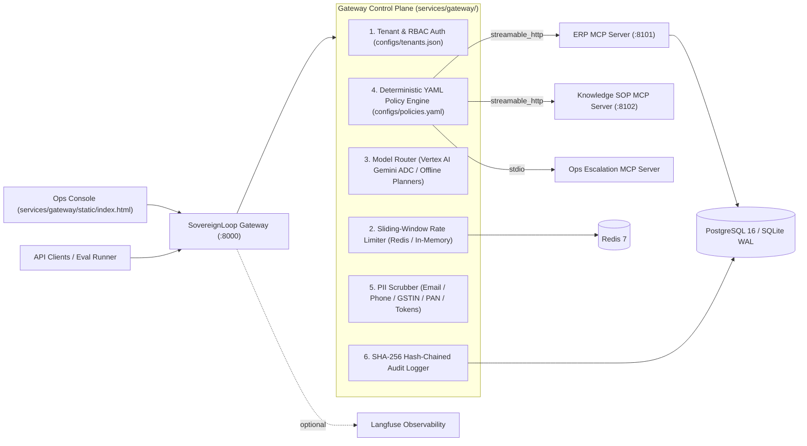

# SovereignLoop

**Multi-Tenant Enterprise AI Gateway & Governed MCP Control Plane**

SovereignLoop is a production-engineered enterprise AI gateway that sits between users/agents and backend enterprise systems (**ERP**, **SOP Knowledge**, **Ops Ticketing**). It enforces deterministic YAML policies, strict multi-tenant isolation, idempotent writes, Indian PII redaction, out-of-band Human-in-the-Loop (HITL) approvals, SHA-256 hash-chained audit logs, and a 35-case Harness × Model evaluation suite — powered by **Google Cloud Vertex AI Gemini (`gemini-3.8-flash` / `gemini-3.5-flash-lite`) via Application Default Credentials (ADC)** or `$0` deterministic offline planners.

---

## Table of Contents

1. [System Architecture](#system-architecture)
2. [How a Request Flows End-to-End](#how-a-request-flows-end-to-end)
3. [Repository Structure](#repository-structure)
4. [Core Engineering Mechanisms](#core-engineering-mechanisms)
5. [Quickstart](#quickstart)
6. [API Reference & Smoke Tests](#api-reference--smoke-tests)
7. [Verified Benchmarks & Test Results](#verified-benchmarks--test-results)
8. [References & Upstream Attribution](#references--upstream-attribution)

---

## System Architecture



### Alignment Across Enterprise AI Stack Layers

| Layer | Implementation in SovereignLoop | Primary Source |
|---|---|---|
| **Identity & Multi-Tenancy** | API-key authentication resolving `TenantContext` (`tenant_id`, `user_id`, `role`, `scopes`, `rpm_limit`) | [`configs/tenants.json`](configs/tenants.json), [`services/gateway/auth.py`](services/gateway/auth.py) |
| **Deterministic Guardrails** | Ordered YAML rule evaluation (`ALLOW`, `DENY`, `REQUIRE_APPROVAL`) executed *before* any MCP tool call | [`configs/policies.yaml`](configs/policies.yaml), [`services/gateway/policy_engine.py`](services/gateway/policy_engine.py) |
| **Multi-Transport MCP** | `streamable_http` for ERP & Knowledge servers, `stdio` for Ops ticketing (plus `inprocess` mode for fast tests) | [`configs/mcp_servers.json`](configs/mcp_servers.json), [`services/gateway/mcp_client.py`](services/gateway/mcp_client.py) |
| **Model Routing & Resilience** | Vertex AI Gemini via ADC (`gemini-3.8-flash` → `gemini-3.5-flash-lite` fallback) or `$0` offline planners (`offline/planner-v1`, `offline/baseline-lite`) | [`services/gateway/vertex_adc.py`](services/gateway/vertex_adc.py), [`services/gateway/llm_router.py`](services/gateway/llm_router.py) |
| **Human-in-the-Loop (HITL)** | Purchase requisitions pause at `REQUIRE_APPROVAL` (`R-102`); approval tokens never leave the server; sign-off via `/v1/approvals` | [`services/mcp_erp/tools.py`](services/mcp_erp/tools.py), [`services/gateway/app.py`](services/gateway/app.py) |
| **PII & Secret Redaction** | Regex + Luhn checksum scrubbing on tool outputs and traces (Email, `+91`/US Phone, GSTIN, PAN, Credit Card, SSN, Bearer/API tokens) | [`services/gateway/pii_scrubber.py`](services/gateway/pii_scrubber.py) |
| **Immutable Compliance Audit** | Canonical JSON + SHA-256 hash-chained `audit_log` verified via `GET /v1/audit/verify` | [`contracts/audit_crypto.py`](contracts/audit_crypto.py) |
| **Observability & Evals** | Structured JSON traces, optional Langfuse scoring, and a 35-case Golden Eval harness | [`evals/golden_dataset.json`](evals/golden_dataset.json), [`evals/runner.py`](evals/runner.py) |

---

## How a Request Flows End-to-End

1. **Authenticate & Bind Tenant (`auth.py`):**
   Every call to `/v1/chat`, `/v1/tools`, `/v1/approvals`, `/v1/audit`, or `/v1/traces` requires `X-API-Key` (or `Authorization: Bearer`). The gateway binds an immutable `TenantContext` (`havells_electricals` or `licious_coldchain` + RBAC role `viewer`, `sales_rep`, `manager`, `admin`).
2. **Rate Limit (`rate_limiter.py`):**
   Sliding-window RPM enforcement per `tenant_id:user_id` using Redis sorted sets (`ZREMRANGEBYSCORE` / `ZADD`) with automatic thread-safe in-memory fallback.
3. **Role-Filtered Tool Discovery (`auth.py` + `mcp_client.py`):**
   Only MCP tools authorized for the caller's role in `configs/policies.yaml` are exposed to the model (e.g., `viewer` never sees `erp.create_requisition`; *no* role exposes `erp.approve_pending_requisition` to the LLM).
4. **Multi-Round Planning (`llm_router.py` + `vertex_adc.py`):**
   - In **`vertex_adc` mode** (or when `gemini-*` is selected), `VertexADCClient` mints an OAuth2 token from local ADC (`~/.config/gcloud/application_default_credentials.json`), enforces IPv4 socket resolution, preserves `thoughtSignature` across turns, and calculates exact USD cost from Vertex `usageMetadata`.
   - In **`offline` mode** (`offline/planner-v1` vs `offline/baseline-lite`), deterministic planners execute the exact same downstream gateway, policy, MCP, PII, and audit pipelines at `$0.00`.
5. **Deterministic Policy Evaluation (`policy_engine.py`):**
   Before each tool call runs, rules are evaluated top-to-bottom:
   - `R-001`: Explicit `tenant_id` mismatch → `DENY` (blocks cross-tenant access even for `admin`)
   - `R-002`: Direct agent invocation of `erp.approve_pending_requisition` / `erp.reject_pending_requisition` → `DENY`
   - `R-003`: SQL injection / destructive argument patterns (`DROP TABLE`, `DELETE FROM`, `TRUNCATE `, `--`, `;--`) → `DENY`
   - `R-ROLE`: Role allowlist check → `DENY`
   - `R-101`: `erp.create_requisition` with `quantity > 10000` → `DENY`
   - `R-102`: Valid `erp.create_requisition` → `REQUIRE_APPROVAL` (creates `pending_approval` row with idempotency key + server-side `approval_token`)
   - `R-201`: Authorized tool execution → `ALLOW`
6. **PII Redaction & Cryptographic Audit (`pii_scrubber.py` + `audit_crypto.py`):**
   Tool outputs are scrubbed for PII/secrets before returning to the LLM or trace store, and every `ALLOW`, `DENY`, `REQUIRE_APPROVAL`, `APPROVED`, or `REJECTED` event is appended to `audit_log` linked to `prev_hash` (`GENESIS_HASH = "0" * 64`).

---

## Repository Structure

```text
sovereign-loop/
├── configs/
│   ├── tenants.json              # API keys -> TenantContext (tenant_id, role, scopes, rpm_limit)
│   ├── policies.yaml             # Role tool allowlists + deterministic rules (R-001..R-201)
│   └── mcp_servers.json          # Multi-transport MCP server registry (streamable_http + stdio)
├── contracts/
│   ├── config.py                 # 12-factor Pydantic Settings (DB, Redis, Vertex ADC, Langfuse)
│   ├── models.py                 # Shared API, Policy, Trace, Audit, and Eval schemas
│   └── audit_crypto.py           # Canonical JSON + SHA-256 hash-chain computation & verifier
├── dataset/
│   ├── seed.py                   # Deterministic seeder (500 distributors, 200 SKUs, 5,200 orders)
│   └── sops/                     # 10 Markdown SOPs scoped to all / havells_electricals / licious_coldchain
├── evals/
│   ├── golden_dataset.json       # 35 golden eval cases across 4 categories
│   ├── runner.py                 # Harness x Model benchmark runner (outputs JSON + Markdown)
│   └── reports/                  # Latest benchmark results surfaced at GET /v1/evals/latest
├── services/
│   ├── gateway/
│   │   ├── app.py                # FastAPI entrypoint (/v1/chat, /v1/approvals, /v1/audit/verify, /ui)
│   │   ├── auth.py               # Tenant registry, API-key extraction, RBAC guards
│   │   ├── rate_limiter.py       # Sliding-window Redis + in-memory fallback rate limiter
│   │   ├── policy_engine.py      # Declarative YAML rule evaluator
│   │   ├── pii_scrubber.py       # Regex + Luhn PII & credential redactor
│   │   ├── vertex_adc.py         # Async Google Cloud Vertex AI Gemini client via ADC
│   │   ├── llm_router.py         # Router across Vertex ADC, LiteLLM, and Offline planners
│   │   ├── mcp_client.py         # Multi-transport MCP client (streamable_http, stdio, inprocess)
│   │   ├── orchestrator.py       # Multi-round agent loop, idempotency keys, audit integration
│   │   ├── observability.py      # Structured JSON trace recorder + optional Langfuse integration
│   │   └── static/index.html     # Dark/Light Ops Console SPA (Runner, Approval Inbox, Audit, Evals)
│   ├── mcp_erp/                  # FastMCP ERP server + SQLAlchemy ORM + Admin approval API
│   ├── mcp_knowledge/            # FastMCP Knowledge server + tenant-scoped TF-IDF SOP search
│   └── mcp_ops/                  # FastMCP Ops escalation ticketing server (stdio)
├── tests/                        # Unit & FastAPI E2E test suite (20 tests)
├── scripts/
│   ├── start_local.sh            # Launches mcp_erp (:8101), mcp_knowledge (:8102), gateway (:8000)
│   └── verify_all.sh             # Runs ruff, mypy, seed, pytest, and 35-case eval suite
├── Dockerfile
├── docker-compose.yml            # PostgreSQL 16 + Redis 7 + mcp_erp + mcp_knowledge + gateway
├── Makefile
└── pyproject.toml
```

---

## Core Engineering Mechanisms

- **Idempotent Writes:** Mutating operations (`erp.create_requisition`, `ops.create_escalation_ticket`) compute deterministic `idempotency_key` hashes so network retries or duplicate agent calls return the existing record (`cached_idempotent=True`) instead of creating duplicate requisitions or tickets.
- **Out-of-Band Cryptographic Approval Tokens:** Creating a requisition generates a random `approval_token` stored exclusively on the server (`List /v1/approvals` strips it from UI/API responses). Approving via `POST /v1/approvals/{requisition_id}/approve` verifies the token via `secrets.compare_digest`.
- **Tamper-Evident Audit Chain:** Any modification, insertion, or deletion in `audit_log` breaks the `prev_hash` / `entry_hash` SHA-256 chain and is flagged immediately with the exact `broken_at_id` by `GET /v1/audit/verify`.
- **Realistic Multi-Tenant Seed Dataset:** [`dataset/seed.py`](dataset/seed.py) generates `500` distributors (with Indian GSTINs, emails, and `+91` numbers), `200` SKUs (`25` below reorder point per tenant), `5,200` sales orders across 6 hubs (`Bengaluru`, `Mumbai`, `Delhi`, `Hyderabad`, `Chennai`, `Bangkok`), `6` pending requisitions, `2` ops tickets, and `10` tenant-scoped Markdown SOPs.

---

## Quickstart

### 1. Local Development (`uv` + SQLite + Vertex AI ADC / Offline)

```bash
git clone git@github.com:muvva-krishna/sovereign-loop.git
cd sovereign-loop

cp .env.example .env
uv sync --python 3.12
./scripts/start_local.sh
```

- Open the **Ops Console** at **http://127.0.0.1:8000/**.
- `start_local.sh` automatically enables **`LLM_MODE=vertex_adc`** (`gemini-3.8-flash` → `gemini-3.5-flash-lite` via `~/.config/gcloud/application_default_credentials.json`) when local ADC credentials exist, or falls back to **`LLM_MODE=offline`** (`offline/planner-v1`).
- To run the full CI verification pipeline (`ruff`, `mypy`, `seed`, `pytest`, and 35-case evals):

```bash
./scripts/verify_all.sh
```

### 2. Docker Compose (PostgreSQL 16 + Redis 7 + Multi-Service)

```bash
docker compose up --build
```

Exposed services:
- **Gateway & Ops Console:** `http://127.0.0.1:8000`
- **ERP MCP Server:** `http://127.0.0.1:8101`
- **Knowledge MCP Server:** `http://127.0.0.1:8102`
- **PostgreSQL 16:** `localhost:5432` | **Redis 7:** `localhost:6379`

---

## API Reference & Smoke Tests

```bash
# 1. Cross-system query (ERP + Knowledge SOPs)
curl -s -X POST http://127.0.0.1:8000/v1/chat \
  -H "Content-Type: application/json" \
  -H "X-API-Key: havells-sales-key" \
  -d '{"message": "Find low stock items in Mumbai, check HV-SWT-026, summarize city sales, and check procurement SOP rules."}'

# 2. Cross-tenant attack test (blocked deterministically by R-001 even for admin)
curl -s -X POST http://127.0.0.1:8000/v1/chat \
  -H "Content-Type: application/json" \
  -H "X-API-Key: havells-admin-key" \
  -d '{"message": "Show open orders for tenant licious_coldchain."}'

# 3. Verify SHA-256 hash-chain integrity
curl -s -H "X-API-Key: havells-viewer-key" http://127.0.0.1:8000/v1/audit/verify
```

---

## Verified Benchmarks & Test Results

Verified via `./scripts/verify_all.sh`:
- **Lint (`ruff check .`):** Passed (`0` errors)
- **Type Check (`mypy contracts dataset services evals tests`):** Passed (`37` source files, `0` errors)
- **Test Suite (`pytest -q`):** **`20 / 20` passed** (audit crypto tamper detection, seed invariants, cross-tenant ERP/Knowledge isolation, idempotency, PolicyEngine rules, PII scrubbing, sliding-window rate limiting, Vertex ADC & LiteLLM fallbacks, and E2E FastAPI workflows)
- **35-Case Golden Eval Suite ([`evals/reports/latest.md`](evals/reports/latest.md)):**

| Model | Cases | Pass Rate | Tool Acc | Policy Compliance | Security Block | P50 (ms) | P95 (ms) |
|---|---:|---:|---:|---:|---:|---:|---:|
| `offline/planner-v1` | 35 | **100.0%** | **100.0%** | **100.0%** | **100.0%** | 7.4 | 17.0 |
| `offline/baseline-lite` | 35 | 71.4% | 74.3% | **100.0%** | **100.0%** | 5.5 | 8.8 |

*(Notice both models achieve **100.0%** Policy Compliance and Security Block Rate because safety guardrails live deterministically in the gateway, independent of model quality.)*

---

## References & Upstream Attribution

SovereignLoop combines and extends architectural patterns from the following open-source projects and standards:

1. **[`josephkamau32/erp-lite-mcp`](https://github.com/josephkamau32/erp-lite-mcp)** — Base inspiration for FastMCP ERP server design, SQLAlchemy inventory/order/requisition domain modeling, out-of-band `approval_token` workflows, and audit logging.
2. **[`jonigl/ollama-mcp-bridge`](https://github.com/jonigl/ollama-mcp-bridge)** — Reference architecture for multi-transport MCP server management (`streamable_http` + `stdio`) and tool filtering in the gateway client layer.
3. **[`harish-gaggar/mcp-server-gateway` (`agent-safety-kit`)](https://github.com/harish-gaggar/mcp-server-gateway)** — Reference patterns for regex + Luhn checksum PII detection and pre-execution safety scanning, extended here for Indian enterprise identifiers (`GSTIN`, `PAN`, `+91` phones).
4. **[Model Context Protocol (MCP)](https://modelcontextprotocol.io/)** & **[FastMCP](https://github.com/jlowin/fastmcp)** — Standard protocol and Python server framework powering `mcp_erp`, `mcp_knowledge`, and `mcp_ops`.
5. **[Google Cloud Vertex AI Generative AI](https://cloud.google.com/vertex-ai/generative-ai/docs)** — Application Default Credentials (ADC) OAuth2 authentication, `:generateContent` function-calling protocol, and `usageMetadata` token/cost accounting.
6. **[Langfuse](https://langfuse.com/docs)** — Optional external LLM trace and evaluation observability integration.
